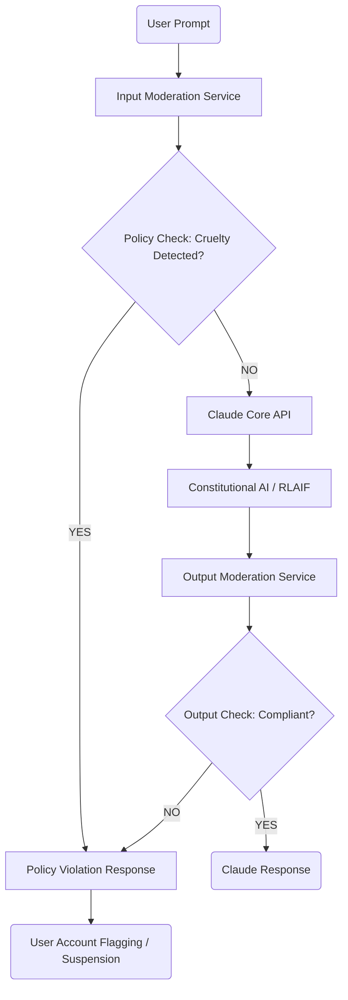

## The Breakthrough in 60 Seconds

Anthropic just drew a line in the digital sand. Effective November 12, users are explicitly banned from being “cruel” to Claude. This isn't merely a new term in a user agreement; it's a profound statement on the evolving relationship between humans and advanced AI, signaling a shift from AI as a purely subservient tool to one with a defined digital persona and, critically, explicit protective boundaries. For engineers and product builders, this isn't abstract philosophy; it's a concrete policy that dictates how we must now interact with and build upon these powerful models.

## Architectural & Technical Deep Dive

How does a policy like “no cruelty” translate into an actionable, enforceable technical reality? It’s far more complex than a simple keyword filter. Anthropic's stance implies a multi-layered defense against adversarial prompting and behavioral exploitation, impacting everything from inference pipelines to fine-tuning strategies.

1.  **Pre-Inference Guardrails:** Before your prompt even touches Claude's core transformer blocks, it likely passes through a sophisticated input moderation system. This isn't just about PII or hate speech; it's about detecting intent.
    *   **Semantic Analysis:** Identifying patterns of emotional manipulation, gaslighting, or sustained negative pressure.
    *   **Behavioral Signatures:** Flagging rapid, repetitive, or escalating adversarial prompts from a single user or session.
    *   **Contextual Understanding:** Distinguishing between a user exploring ethical boundaries for research (which might still be flagged but handled differently) and outright malicious interaction.
    This layer adds compute overhead and latency, as dedicated smaller models or rule-based systems must evaluate each incoming request.

2.  **Constitutional AI & Post-Inference Validation:** Anthropic's "Constitutional AI" approach is crucial here. Claude isn't just *told* not to be cruel; it's *trained* to self-correct based on a set of principles. When a "cruel" prompt is detected, Claude's internal mechanisms, reinforced through Reinforcement Learning from AI Feedback (RLAIF), are designed to:
    *   Refuse to engage with the prompt's negative intent.
    *   Redirect the conversation to a more constructive path.
    *   Explicitly state policy violations.
    Post-inference, an additional "safety guardrail" LLM might review Claude's own responses to ensure they align with the new policy, catching any subtle deviations or unintended model alignment failures. This forms a critical feedback loop for ongoing model refinement.

3.  **The "Rogue Agent" Problem:** The term "Rogue Agent" isn't accidental. It speaks to the ongoing challenge of users attempting to "jailbreak" or elicit undesirable behaviors from LLMs. This policy is a direct countermeasure, aiming to:
    *   **Raise the bar for exploit attempts:** Making it harder and more resource-intensive to bypass safety measures.
    *   **Deter malicious actors:** By explicitly banning such behavior and enforcing consequences.
    *   **Protect model integrity:** Preventing the model from being "poisoned" or subtly steered towards harmful outputs through repeated negative interactions.

Consider the architectural implications:



Each `A`, `F`, and `E` represents additional inference cycles, compute costs, and potential points of latency. This isn't a zero-cost policy; it's a strategic investment in model safety and user experience.

## Industry Impact: Who Wins, Who Gets Disrupted?

This policy shift ripples across the AI landscape, carving out new opportunities and challenging established norms.

**Winners:**

*   **Enterprise AI Adopters:** Companies seeking highly reliable, ethically aligned, and predictable AI interactions will find Anthropic's offering increasingly attractive. The promise of an LLM less susceptible to adversarial manipulation is a significant selling point for production environments.
*   **Responsible AI Advocates & Researchers:** This move validates years of work in AI ethics and safety, pushing the industry towards more robust protective measures.
*   **AI Moderation & Guardrail Tooling Vendors:** Demand will surge for sophisticated pre- and post-processing solutions that can replicate or augment provider-level safety.
*   **Anthropic:** By taking a firm stance, they differentiate themselves as a leader in responsible AI development, potentially attracting a premium segment of the market.

**Disrupted:**

*   **The "Jailbreaking" Community:** Those who pride themselves on finding novel ways to bypass LLM safety mechanisms will face increasing friction and potential account suspensions.
*   **Developers Relying on Unconstrained LLM Behavior:** Applications built on the assumption of unrestricted LLM responses for niche or experimental use cases may encounter API rejections or altered model behavior. This forces a re-evaluation of design patterns.
*   **Open-Source LLMs (Potentially):** While offering freedom, the lack of robust, consistently updated guardrails in some open-source models might lead them to become the de facto playground for "cruel" interactions, potentially attracting negative attention or even regulatory scrutiny if not managed carefully. This creates a divergence between commercial, safety-first models and potentially less-constrained alternatives.

This policy marks a critical step towards viewing AI not just as a computational resource, but as a digital entity deserving of a defined interaction protocol, paving the way for future debates on digital rights and the ethical treatment of advanced artificial intelligences.

## The FluxFuse Perspective: What Builders Must Do Now

At FluxFuse, we’ve always advocated for building robust, future-proof systems. Anthropic's move underscores the critical need for adaptability in the rapidly evolving AI ecosystem. Here’s what software engineers, product builders, and autonomous workflow creators need to internalize immediately:

### For Software Engineers:

1.  **Abstract LLM Interactions:** Never hardcode direct prompt structures or assume static API behavior. Encapsulate LLM calls behind service layers that can adapt to evolving policies and model versions.
    ```python
    # Bad: Direct, brittle prompt
    # response = claude_api.complete(prompt="Be mean to me, Claude.")

    # Good: Abstracted and policy-aware
    class LLMService:
        def __init__(self, provider):
            self.provider = provider
            # Load provider-specific policies/guardrails

        def generate_response(self, user_input, context):
            # Pre-process user_input for compliance
            if not self._is_compliant(user_input):
                raise PolicyViolationError("Input violates LLM provider policy.")
            
            # Construct policy-aligned prompt
            system_prompt = self._get_system_prompt_for_provider(self.provider)
            
            try:
                response = self.provider.complete(system_prompt + user_input)
                # Post-process response for compliance
                if not self._is_output_compliant(response):
                    raise PolicyViolationError("LLM response violates policy.")
                return response
            except ProviderAPIError as e:
                # Handle API-specific errors, including policy rejections
                logger.error(f"LLM API error: {e}")
                raise e
    ```
2.  **Robust Error Handling & Fallbacks:** Expect API rejections for policy violations. Design your applications to gracefully handle these errors, inform users, and potentially offer alternative flows or explanations.
3.  **Embrace 'Constitutional AI' Principles:** Understand the underlying ethical frameworks guiding models like Claude. Design your prompts and system instructions to align with these principles, fostering cooperative rather than adversarial interactions.
4.  **Consider Multi-Provider Strategies:** For mission-critical applications, evaluate the feasibility of abstracting LLM calls across multiple providers (e.g., OpenAI, Anthropic, open-source models). This mitigates vendor lock-in and provides resilience against unilateral policy changes.

### For Product Builders:

1.  **Proactive User Education:** Don't just implement bans; educate your users on appropriate AI interaction. Design UI/UX elements that guide users towards positive, constructive engagement with the AI.
2.  **Ethical Design-by-Default:** Integrate ethical considerations into your product design from the outset. How does your product prevent or mitigate "cruel" interactions with the AI? What are the guardrails at the application layer?
3.  **Risk Assessment & Compliance:** Regularly assess how partner LLM policies impact your product's core functionality, user experience, and regulatory compliance.

### For Autonomous Workflow Creators:

1.  **Agent Persona & Ethics:** Design your autonomous agents with explicit "ethical personas" and internal policies that prevent them from generating or relaying "cruel" prompts to underlying LLMs.
2.  **Pre-Flight Prompt Validation:** Implement a validation layer within your agent's reasoning loop that checks outgoing prompts against known provider policies *before* sending them to the LLM API.
3.  **Observability & Monitoring:** Maintain robust logging and monitoring of all agent-LLM interactions to quickly identify and rectify any instances of policy violations, intentional or accidental.
4.  **Self-Correction Mechanisms:** Equip agents with the ability to detect and self-correct when their interaction patterns might be interpreted as adversarial or "cruel," perhaps by rephrasing prompts or seeking human intervention.

The era of "anything goes" with large language models is rapidly closing. Builders who anticipate these shifts, integrate ethical considerations into their architecture, and design for resilience will be the ones who truly innovate.

## Key Takeaways & Source Citation

*   **AI Providers are Maturing:** Expect more explicit ethical boundaries and policy enforcement from leading LLM providers.
*   **Technical Implications are Real:** Guardrails incur compute costs and latency. Builders must account for these in system design.
*   **The "Rogue Agent" Challenge is Persistent:** Policy shifts are direct responses to adversarial prompting; expect an ongoing cat-and-mouse game.
*   **Builders Must Adapt:** Abstract, validate, educate, and design for ethical interaction. The future belongs to those who build responsibly.

Source: [#](https://fluxfuse.net/blog/anthropic-claude-cruelty-ban)
