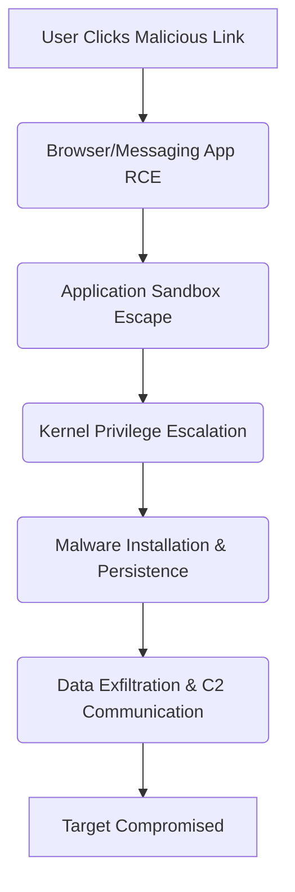

## The Breakthrough in 60 Seconds

The digital battlefield just got a whole lot more treacherous. Researchers have just confirmed that a sophisticated, likely Kremlin-sponsored group has successfully leveraged simultaneous zero-day exploits across *both* iOS and Android, infecting devices belonging to diplomatic targets. This isn't a speculative threat; it's a stark, real-world demonstration that even the most robust mobile operating systems, backed by multi-billion dollar security budgets, remain vulnerable to determined, well-resourced adversaries. For anyone building on, or relying on, these platforms, this isn't just news—it's a paradigm shift in threat modeling.

## Architectural & Technical Deep Dive

To simultaneously compromise two distinct, highly-hardened mobile operating systems like iOS and Android with zero-days is not merely difficult; it represents an apex predator level of offensive security engineering. This isn't about phishing or social engineering; it's about deep architectural flaws. While specific exploit details are undisclosed, the attack likely chained multiple vulnerabilities, exploiting complex interactions between hardware, kernel, and userland components.

Consider the typical layers of defense that must be bypassed:

1.  **Application Sandbox Escape:** Both iOS and Android heavily rely on sandboxing to isolate applications. An initial compromise (e.g., via a malicious link in a browser or messaging app) would first require escaping this sandbox to access broader system resources.
2.  **Kernel Privilege Escalation:** Gaining control over the kernel is the holy grail for attackers, granting root or system-level privileges. This often involves exploiting memory corruption bugs (e.g., use-after-free, integer overflows) in kernel drivers or system calls.
3.  **Persistence Mechanism:** Once privileges are escalated, the exploit needs to establish persistence, surviving reboots and potentially evading detection by EDR (Endpoint Detection and Response) or mobile threat defense solutions.
4.  **Exfiltration & C2:** Finally, the malware would need to securely exfiltrate data and maintain a covert command-and-control channel.



*ASCII Representation (Conceptual Attack Chain):*

```
┌─────────────────────────┐
│ User Clicks Malicious Link │
└───────────┬─────────────┘
            │
            ▼
┌─────────────────────────┐
│ Browser/Messaging App RCE │
│  (e.g., WebKit/Blink bug) │
└───────────┬─────────────┘
            │
            ▼
┌─────────────────────────┐
│ Application Sandbox Escape │
│  (Bypass OS isolation)  │
└───────────┬─────────────┘
            │
            ▼
┌─────────────────────────┐
│ Kernel Privilege Escalation │
│    (Gain root/system)   │
└───────────┬─────────────┘
            │
            ▼
┌─────────────────────────┐
│ Malware Installation &  │
│       Persistence       │
└───────────┬─────────────┘
            │
            ▼
┌─────────────────────────┐
│ Data Exfiltration & C2  │
│     Communication       │
└───────────┬─────────────┘
            │
            ▼
┌─────────────────────────┐
│   Target Compromised    │
└─────────────────────────┘
```

The compute economics for such an operation are staggering. Developing *one* reliable zero-day for a single platform is a multi-million dollar endeavor, requiring highly specialized talent and extensive reverse engineering. Developing *two* concurrent, cross-platform exploits points to a state-level budget and a long-term investment in offensive capabilities. This isn't about latency/throughput tradeoffs; it's about the ultimate throughput of intelligence gathering, justifying immense investment.

## Industry Impact: Who Wins, Who Gets Disrupted?

This incident sends ripples across the entire tech ecosystem:

*   **Mobile OS Vendors (Apple, Google):** While they will patch these flaws, the reputational damage and the erosion of trust are significant. It underscores that even their walled gardens are penetrable. Expect increased investment in fuzzing, bug bounties, and supply chain security.
*   **Enterprise Mobility & Security:** Companies relying on MDM (Mobile Device Management) and EDR solutions for their corporate fleets will face renewed scrutiny. Zero-day exploits bypass most conventional security layers, forcing a re-evaluation of assumptions about endpoint integrity. The focus will shift even more towards behavioral analytics and proactive threat hunting.
*   **The Zero-Day Market:** This incident reinforces the immense value of cross-platform zero-days. Groups like NSO Group, already under fire, will see their 'product' validated in the black market, potentially fueling further development and proliferation of such tools. The line between state-sponsored and private mercenary operations continues to blur.
*   **Privacy Advocates & Geopolitics:** The targeting of diplomatic personnel highlights the geopolitical stakes. This isn't just about data theft; it's about intelligence advantage, espionage, and potentially undermining international relations. For citizens, it further erodes confidence in the fundamental privacy of their most personal device.
*   **Developer Tooling & Infrastructure:** For builders of developer tools, this emphasizes the criticality of secure-by-design principles. Any tool interacting with user devices, or even CI/CD pipelines, becomes a potential vector if not rigorously secured.

## The FluxFuse Perspective: What Builders Must Do Now

At FluxFuse Technologies, we live and breathe the intersection of developer tools, robust utilities like Notchgent, and the cutting edge of enterprise AI automations. This mobile zero-day revelation isn't just an abstract security alert; it's a direct challenge to the foundational trust layer our products and our users operate within. Here's what every builder, architect, and autonomous workflow creator must internalize:

1.  **Assume Compromise, Design for Resilience:** The 'perimeter' is dead. Your users' endpoints *will* be compromised. Your job is to design systems that limit the blast radius, detect anomalies swiftly, and recover gracefully. Implement zero-trust principles aggressively, even for internal services.
2.  **Harden Your Supply Chain:** These exploits often start with subtle flaws in dependencies or build processes. Scrutinize every third-party library, every external API, and every CI/CD pipeline step. Automated dependency scanning (SAST/DAST) is non-negotiable.
3.  **Elevate Threat Modeling:** Move beyond generic OWASP Top 10. Engage in deep, adversarial threat modeling sessions. What's the worst-case scenario if a user's phone running your app is compromised? How could an attacker leverage your app's permissions or data? For Notchgent, this means continuous hardening of its desktop environment interactions and update mechanisms.
4.  **Secure Your AI Agents' Endpoints:** Our work in enterprise AI automations means our autonomous agents often interact with data on user devices or enterprise networks. If the underlying endpoint is compromised, the agent's actions can be subverted. Implement robust authentication, authorization, and encrypted communication channels for *all* agent interactions, assuming the network and endpoint are hostile.
5.  **Focus on Observability & Anomaly Detection:** When prevention fails, detection is your last line of defense. Build robust logging, telemetry, and monitoring into your applications and infrastructure. Look for unusual network activity, unexpected process spawns, or deviations from normal behavior patterns – indicators that could signal a zero-day exploitation.
6.  **Prioritize Patch Management & Update Cadence:** While zero-days are, by definition, unpatched, the window of vulnerability is often short. Ensure your applications and underlying platforms are always on the latest, patched versions. Educate users on the critical importance of OS updates.

This isn't about fear; it's about rigor. As builders, we have a responsibility to our users and our systems. The bar for security has just been raised, and it's time to meet it with engineering excellence.

## Key Takeaways & Source Citation

*   Sophisticated, likely state-sponsored actors exploited simultaneous zero-days on both iOS and Android.
*   Diplomatic targets were compromised, highlighting geopolitical espionage stakes.
*   These exploits bypass traditional security layers, demanding a shift to resilience and deep threat modeling.
*   Builders must assume endpoint compromise, harden their supply chains, and bolster observability for their applications and AI agents.

[Source: Ars Technica](https://arstechnica.com/security/2026/11/hackers-exploited-ios-and-android-flaws-to-infect-phones/)

