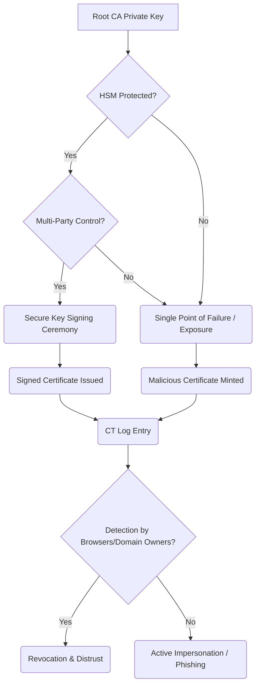

## The Breakthrough in 60 Seconds

eMudhra, a long-standing Certificate Authority, has spectacularly exited the TLS business, shuttering its operations in the wake of a catastrophic security breach. The core of the issue: a "flubbed key signing ceremony" that compromised a critical private key, enabling the minting of fraudulent web credentials for *any* site. This isn't merely a lapse; it's a fundamental betrayal of the trust model underpinning the entire secure web, forcing a re-evaluation of the human and technical safeguards we rely on for digital identity.

## Architectural & Technical Deep Dive

The integrity of the internet's trust model hinges on Certificate Authorities (CAs) like eMudhra rigorously protecting their private keys. These keys are the cryptographic bedrock, used to sign digital certificates that browsers then trust to verify a website's identity. When a CA's private key is compromised, it's akin to handing a master key to every digital lock on the internet.

**The 'Flubbed Ceremony' Dissected:**

A key signing ceremony is a highly controlled, multi-person event designed to minimize the risk of private key exposure. Typically, it involves:

1.  **Hardware Security Modules (HSMs):** Private keys are stored within FIPS 140-2 Level 3 (or higher) certified HSMs – tamper-resistant physical devices designed to prevent extraction of the key material.
2.  **Multi-Party Control (M of N):** Access to the HSM (and thus, the private key) requires multiple distinct individuals, each holding a piece of the activation puzzle (e.g., smart cards, passwords). This ensures no single person can unilaterally compromise the key.
3.  **Physical Security:** The ceremony occurs in a secure, often air-gapped facility, with video surveillance and strict access controls.
4.  **Auditing & Logging:** Every action is meticulously logged and audited to provide an immutable trail.

eMudhra's failure suggests a breakdown in one or more of these critical layers. The report indicating the compromise of "cert private key of 4" points to a specific, identifiable key that was either improperly generated, stored, or accessed during a ceremony that clearly lacked the necessary rigor. This isn't a complex zero-day exploit; it's a procedural and operational failure at the most sensitive point of the CA's security architecture.

**The Mechanics of Trust Erosion:**

When a CA's private key is misused, an attacker can issue certificates for domains they don't own. These certificates will appear legitimate to browsers because they are signed by a trusted root. Detection often relies on:

*   **Certificate Transparency (CT) Logs:** Public, append-only logs where all newly issued certificates *should* be recorded. This allows domain owners and security researchers to monitor for unauthorized certificates. The question isn't just *if* eMudhra's certificates were logged, but *when* and *how* quickly the fraudulent ones were detected and acted upon.
*   **Browser/OS Revocation:** Once a compromise is detected, browsers and operating systems must revoke trust in the compromised certificates and, in severe cases, the entire CA. This is a slow, distributed process, leaving a window of vulnerability.

*(Note: Mermaid syntax is used here for conceptual clarity, representing a flowchart. In a real-world scenario, this would be rendered visually.)*

The eMudhra incident highlights that even with sophisticated cryptographic primitives, human process failures remain the weakest link.

## Industry Impact: Who Wins, Who Gets Disrupted?

This isn't an isolated incident; it's another tremor in the foundation of the centralized CA model. The ripple effects will be significant:

*   **Increased Scrutiny on CAs:** Browser vendors (Google, Mozilla, Apple) will undoubtedly tighten their already stringent requirements for CAs. Expect more rigorous audits, demand for greater automation, and potentially even higher financial penalties for non-compliance. Smaller, less mature CAs may find it increasingly difficult to meet these escalating standards, leading to further market consolidation.
*   **Acceleration of Automation:** Services like Let's Encrypt, which leverage the Automated Certificate Management Environment (ACME) protocol, will see their value proposition reinforced. Their model of short-lived, automatically renewed certificates issued via audited, open-source infrastructure minimizes the human element and the impact of a single key compromise.
*   **Erosion of Trust in Traditional CAs:** Every such incident chips away at public and developer trust. While the system largely holds, the cognitive load of constantly questioning certificate validity grows.
*   **Push for Decentralized Trust Models:** While not a panacea, incidents like eMudhra's fuel the long-term interest in alternative trust architectures, such as those based on Decentralized Identifiers (DIDs) or blockchain-based verifiable credentials. These aim to distribute trust, reducing reliance on single points of failure, though they come with their own set of complexities and adoption hurdles.
*   **Security Tooling Evolution:** Expect a surge in demand for tools that proactively monitor Certificate Transparency logs, automate certificate lifecycle management, and provide real-time alerting for anomalous certificate issuance.

## The FluxFuse Perspective: What Builders Must Do Now

For software engineers, product builders, and autonomous workflow creators, eMudhra's downfall is a stark reminder: *trust is an architectural concern, not just a policy document.* We must build resilience against trust failures into our systems.

**For Software Engineers:**

*   **Embrace ACME & Automation:** If you're still manually managing TLS certificates, stop. Migrate to ACME clients (like Certbot) and automate certificate provisioning and renewal. Short-lived certificates (90 days or less) dramatically reduce the window of vulnerability if a CA is compromised.
*   **Monitor Certificate Transparency (CT) Logs:** Integrate CT log monitoring into your security pipeline. Tools like `certstream` (or building your own listeners) can provide near real-time alerts if a certificate is issued for your domain without authorization. This proactive monitoring is your first line of defense against rogue certificates.
*   **Understand and Implement DNSSEC + DANE (TLSA):** For critical infrastructure, consider deploying DNSSEC and DANE (DNS-based Authentication of Named Entities) records. DANE allows you to publish the expected TLS certificate or public key for your domain directly in DNS, providing an out-of-band verification mechanism that can detect CA misissuance before browsers do (for clients that support it).

**For Product Builders:**

*   **Security by Design, Not as an Afterthought:** Bake certificate lifecycle management, CT log monitoring, and automated revocation processes directly into your product's architecture. Assume CAs *can* and *will* be compromised.
*   **Educate Your Users:** While not directly actionable by users, understanding the implications of certificate trust can help them make informed decisions about browser warnings and security practices.
*   **Diversify Trust:** For highly sensitive applications, explore multi-CA strategies or layered security models that don't rely on a single point of trust.

**For Autonomous Workflow Creators:**

*   **Automate Validation & Remediation:** Your CI/CD pipelines should automatically validate certificate validity, check CT logs post-deployment, and trigger alerts or even automated rollback procedures if unauthorized certificates are detected.
*   **Policy as Code for Trust:** Define your organization's certificate issuance and validation policies as code, ensuring consistent application and auditability across all automated deployments.
*   **Integrate with Security Orchestration:** Ensure your automation platforms can integrate with security orchestration, automation, and response (SOAR) systems to rapidly respond to certificate-related incidents.

This incident isn't just eMudhra's problem; it's a collective challenge to reinforce the digital trust we all depend on. The solution lies in relentless automation, proactive monitoring, and a healthy skepticism towards any single point of failure.

## Key Takeaways & Source Citation

*   **CA Trust is Fragile:** The eMudhra incident underscores that even CAs, the supposed guardians of web trust, are susceptible to fundamental operational and security failures.
*   **Automation is Non-Negotiable:** Manual certificate management and oversight are no longer tenable. Automated tools (ACME, CT log monitoring) are critical.
*   **Proactive Monitoring is Key:** Waiting for browsers to revoke trust is too late. Builders must actively monitor for unauthorized certificate issuance.
*   **Architect for Resilience:** Design systems that anticipate and can quickly adapt to failures in the broader internet trust infrastructure.

[Ars Technica: Disgraced eMudhra drops out of TLS business](https://arstechnica.com/security/2026/10/disgraced-emudhra-drops-out-of-tls-business-following-certificate-debacle/)

