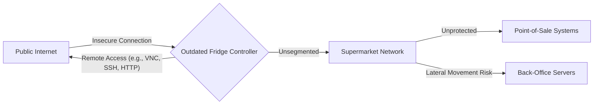

## The Breakthrough in 60 Seconds

The digital equivalent of a grease fire, but far more systemic and expensive, just ravaged 700 supermarkets. A "fridge hack" — leveraging outdated, internet-exposed refrigeration controllers — didn't just spoil produce; it sparked actual fires, costing millions and exposing a gaping chasm in critical infrastructure security. This isn't a sophisticated state-sponsored attack; it's the predictable outcome of neglecting basic security hygiene in the rush to "smartify" everything. The era of the insecure IoT device being a mere nuisance is over. It's now a clear and present danger to physical assets, supply chains, and human safety.

## Architectural & Technical Deep Dive

The core of this catastrophe lies in a fundamental architectural negligence: **direct exposure of vulnerable operational technology (OT) to the public internet without adequate segmentation, patching, or monitoring.** We're talking about devices likely running decades-old embedded Linux kernels or proprietary RTOS, never designed for internet-scale threats, yet left wide open.

Consider the typical deployment model that led to this:

### The Predicament: Flat Networks & Forgotten Devices

This diagram illustrates a common, dangerously simplistic setup. The "smart" fridge controller, perhaps installed years ago by an HVAC contractor, was likely configured with:

1.  **Direct Internet Exposure:** No firewall, no VPN, no secure gateway. Its IP address was simply routable from anywhere.
2.  **Outdated Firmware:** Manufacturers often abandon support for embedded devices quickly. Patching mechanisms are non-existent or ignored.
3.  **Default/Weak Credentials:** The admin password was likely `admin/admin` or similar, never changed.
4.  **Lack of Network Segmentation:** Once compromised, the fridge controller became a beachhead for lateral movement into the broader supermarket network, potentially impacting POS systems, inventory management, or even corporate IT.

The compute economics here are perverse. The marginal cost saved by *not* implementing a secure gateway, *not* maintaining firmware, and *not* segmenting the network is dwarfed by the multi-million dollar losses, not to mention the irreparable brand damage and potential human cost from fires. Latency for temperature monitoring is measured in seconds; the latency for a security patch, apparently, was measured in never. Throughput for fridge data is minimal, but the throughput for an attacker exploiting an open port is effectively infinite.

This incident highlights several critical technical failings:

*   **Absence of Secure Boot and Firmware Integrity:** Compromised devices could load malicious firmware without detection.
*   **Poorly Designed Remote Management:** If remote management was necessary, it should have been via a secure, authenticated VPN, not directly over the internet.
*   **Lack of Telemetry and Anomaly Detection:** No system was apparently flagging unusual network traffic from the fridge controllers or unexpected operational states.
*   **Supply Chain Vulnerabilities:** The original device manufacturers bear significant responsibility for shipping insecure products and failing to provide long-term support.

## Industry Impact: Who Wins, Who Gets Disrupted?

This incident is a brutal market corrector, accelerating shifts already underway.

**Winners:**

*   **Specialized IoT Security Platforms:** Companies offering secure device management, OTA update mechanisms, threat detection for OT, and secure edge compute solutions. Think platforms that enforce zero-trust principles at the device level.
*   **Cyber Insurance Providers:** While premiums will undoubtedly rise, the necessity for robust cyber insurance policies covering physical damage from cyber events will become undeniable.
*   **Managed Security Service Providers (MSSPs):** Especially those with expertise in OT/ICS security and 24/7 monitoring capabilities. Many supermarkets lack the in-house expertise.
*   **Regulatory Bodies & Standard Setters:** Expect increased pressure for mandatory IoT security standards, potentially mirroring requirements seen in critical infrastructure sectors. NIST, ISO, and sector-specific bodies will gain influence.

**Disrupted:**

*   **Insecure IoT Device Manufacturers:** Those who prioritize low cost and rapid deployment over security will face immense reputational damage, legal liabilities, and market rejection. The days of "ship it and forget it" are over.
*   **Supermarket Chains (and other critical infrastructure operators):** Direct financial losses, reputational damage, increased operational costs due to security remediation, and potentially higher insurance costs. This will force a rapid re-evaluation of their OT/IT security posture.
*   **Legacy Integrators:** Companies that deployed and maintained these flat, insecure networks will find their methodologies obsolete and their contracts at risk.
*   **The "Smart Everything" Hype Train:** This incident injects a dose of cold reality into the uncritical adoption of connected devices without a security-first mindset.

The long-term impact will be a systemic re-prioritization of security in the design, deployment, and lifecycle management of all connected devices, especially those interacting with the physical world.

## The FluxFuse Perspective: What Builders Must Do Now

At FluxFuse, we're building the tools for tomorrow's autonomous workflows and robust software. This fridge hack isn't just a cautionary tale; it's a stark validation of our core tenets: **security and lifecycle management are not features, they are foundational.** For software engineers, product builders, and autonomous workflow creators, the message is clear:

1.  **Embed Security from Day Zero (Shift Left Hard):** Threat model *before* you write a line of code. Assume your device will be internet-exposed and targeted. Design for least privilege, secure defaults, and strong authentication. For our desktop utilities like Notchgent, this means rigorous hardening, secure update mechanisms, and clear privacy boundaries.
2.  **Architect for Zero Trust and Segmentation:** Never trust any device or network segment by default. IoT devices *must* reside in isolated VLANs, behind secure gateways, with strict egress/ingress rules. They should communicate only with specific, whitelisted endpoints, ideally through encrypted, authenticated channels.
3.  **Automate Lifecycle Management:** Every connected device needs a robust, automated update strategy. This includes secure over-the-air (OTA) updates, firmware integrity checks, and a clear end-of-life policy. If a device can't be securely updated, it's a liability. Our work on enterprise AI automations emphasizes this: automate patch deployment, configuration management, and vulnerability scanning.
4.  **Build for Observability and Automated Response:** You can't secure what you can't see. Implement comprehensive logging, real-time monitoring, and anomaly detection for *all* connected devices. When a threat is detected, an autonomous workflow should trigger immediate isolation, alerts, and potentially automated remediation steps. This is where our AI capabilities shine – turning raw telemetry into actionable intelligence and automated incident response.
5.  **Scrutinize Your Supply Chain:** Demand transparency and security assurances from every vendor. Request Software Bill of Materials (SBOMs) for all embedded systems. Understand their patching cadence and security posture. If a vendor can't meet your security requirements, find one who can.
6.  **Developer Tools for Security:** We must build and advocate for developer tools that make it *easier* to write secure code, enforce security policies, and test for vulnerabilities in embedded systems. Static analysis, fuzzing, and security testing frameworks tailored for IoT are paramount.

This incident underscores that the physical and digital worlds are inextricably linked. The "smart" future demands "secure" foundations, and it's on us, the builders, to deliver it.

## Key Takeaways & Source Citation

*   **Basic Security Failure:** The fridge hack stemmed from fundamental neglect: outdated, internet-exposed IoT devices.
*   **Physical World Impact:** Insecure IoT is no longer just a data breach risk; it poses direct threats to physical infrastructure and safety.
*   **Architectural Imperative:** Implement network segmentation, secure gateways, and zero-trust principles for all OT/IoT devices.
*   **Lifecycle Management is Critical:** Plan for secure updates and end-of-life from a device's inception.
*   **Builders Must Lead:** Software engineers and product developers are on the front lines, responsible for designing security into every connected system.

**Source:** [Fridge hack costing millions and sparking fires stemmed from poor security](https://arstechnica.com/security/2026/10/fridge-hack-costing-millions-and-sparking-fires-stemmed-from-poor-security/)
