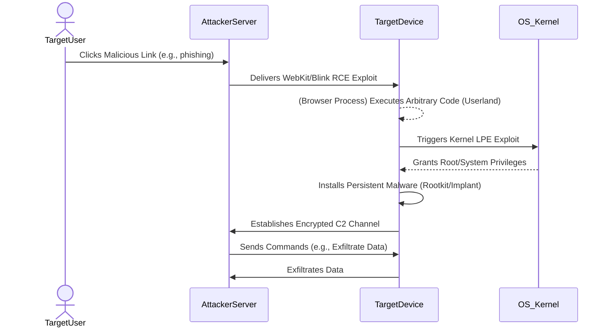

## The Breakthrough in 60 Seconds

Forget the usual cat-and-mouse; this is a full-blown digital war. Researchers have just confirmed that a sophisticated, potentially Kremlin-sponsored, threat actor successfully exploited previously unknown zero-day vulnerabilities across both iOS and Android to infect target phones. The objective? Diplomatic intelligence. This isn't a speculative threat; it's a proven, active campaign that bypassed the world's most hardened mobile operating systems, turning personal devices into high-fidelity surveillance tools. The implications are profound, shifting the ground beneath every security model and development pipeline.

## Architectural & Technical Deep Dive

To compromise two distinct, heavily sandboxed operating systems like iOS and Android simultaneously with zero-days speaks to an unparalleled level of R&D investment and technical prowess. This isn't opportunistic phishing; it's a calculated, multi-stage attack that likely leveraged a chain of exploits.

Consider the typical attack surface for mobile devices:

1.  **Browser Engines (WebKit/Blink):** Often the initial vector. A malicious link could trigger a remote code execution (RCE) vulnerability within the browser's rendering engine, granting initial userland access.
2.  **Kernel-Level Privilege Escalation (LPE):** Once in userland, the attacker needs to break out of the app's sandbox and gain higher privileges to install persistent malware. This requires an LPE exploit targeting the operating system kernel (e.g., `mach_msg` vulnerabilities on iOS, specific driver flaws on Android).
3.  **Persistence Mechanisms:** A truly effective implant must survive reboots and OS updates. This could involve modifying system partitions, injecting into critical system processes, or manipulating update mechanisms – all requiring deep kernel access and an understanding of the OS's boot sequence.
4.  **Covert Command & Control (C2):** Exfiltrating data and receiving new commands without detection demands sophisticated network evasion techniques, often using encrypted channels, legitimate-looking traffic patterns, or even steganography.

An attack chain might look conceptually like this:

The compute economics here are staggering. Developing a single functional zero-day exploit can cost millions, often requiring reverse engineering highly optimized, security-hardened codebases and discovering esoteric edge cases. To possess *multiple* such exploits, across *two* major mobile platforms, targeting kernel-level components, suggests a budget and talent pool only accessible to nation-state actors. This isn't about profit; it's about strategic advantage and intelligence gathering, where the cost of exploit development is dwarfed by the value of the information acquired.

## Industry Impact: Who Wins, Who Gets Disrupted?

This incident sends ripples across the entire tech ecosystem, creating clear winners and exposed vulnerabilities.

**Winners:**

*   **Offensive Security Research:** The market for zero-day vulnerabilities, already robust, will see even higher valuations. Nations and well-funded groups will escalate their hunt for these digital keys.
*   **Advanced Threat Intelligence & Detection:** Companies specializing in detecting nation-state-level threats, anomaly detection, and endpoint detection and response (EDR) solutions will find renewed demand. Their ability to identify sophisticated, stealthy implants becomes paramount.
*   **Hardware-Backed Security Vendors:** Trust in software-only security erodes. Solutions leveraging hardware enclaves (e.g., Apple's Secure Enclave, Android's TrustZone) for critical functions like cryptographic keys and boot integrity will gain further traction.

**Disrupted:**

*   **Mobile OS Vendors (Apple, Google):** While they will undoubtedly patch these flaws rapidly, the reputational hit is real. It undermines the narrative of mobile devices as inherently secure personal fortresses. This puts immense pressure on their security teams and patch delivery mechanisms.
*   **BYOD (Bring Your Own Device) Policies:** Enterprises relying on BYOD face a significantly elevated risk. A compromised personal device used for work can be a direct conduit into corporate networks, making robust mobile device management (MDM) and mobile application management (MAM) solutions even more critical.
*   **App Developers & Ecosystems:** If the underlying OS can be so thoroughly compromised, trust in the security of the app store and third-party SDKs can waver. This pushes developers to adopt even more stringent security practices, from code signing to supply chain auditing.
*   **Privacy Advocates:** This incident highlights the stark reality that even the most advanced consumer devices are not immune to targeted, state-sponsored surveillance, raising significant questions about digital rights and protections.

This event will likely accelerate shifts towards more granular permission models, increased scrutiny of third-party dependencies in OS components, and perhaps even a push for faster, more transparent security update cycles across the industry.

## The FluxFuse Perspective: What Builders Must Do Now

At FluxFuse Technologies, our mission is to empower developers and automate complex workflows. This incident isn't just a news story; it's a stark reminder that security is not a feature, but a foundational requirement. For software engineers, product builders, and autonomous workflow creators, this demands immediate action and a paradigm shift.

**For Software Engineers:**

1.  **Embrace Memory Safety:** Languages like Rust and Swift, with their strong guarantees against common memory errors (buffer overflows, use-after-free), dramatically reduce the attack surface for a significant class of critical vulnerabilities. If your stack allows it, migrate, or at least compartmentalize critical components.
2.  **Rigorous Dependency Auditing:** The supply chain is the new perimeter. Automate scanning of all third-party libraries, SDKs, and packages (`npm audit`, `pip-audit`, `cargo audit`). Don't just scan; understand the *implications* of reported vulnerabilities and actively seek maintainer transparency.
3.  **Threat Modeling as a Core Practice:** Before writing a single line of code, ask: "How could this be abused?" "What data is sensitive?" "What's the worst-case scenario?" Integrate STRIDE (Spoofing, Tampering, Repudiation, Information Disclosure, Denial of Service, Elevation of Privilege) into your design process, especially for components interacting with the OS or network.
4.  **Least Privilege Principle Everywhere:** Applications, services, and even individual functions should operate with the absolute minimum permissions required. Root access is a privilege, not a default.

**For Product Builders & Architects:**

1.  **Prioritize Patching and Update Cadence:** Your product's security posture is directly tied to the underlying OS and library security. Integrate rapid patching and update deployment into your product roadmap, not as an afterthought. For our desktop utility Notchgent, this means a relentless focus on secure update mechanisms and minimal attack surface.
2.  **Secure by Design, Not by Checklist:** Security must be architected in from the ground up. This includes robust sandboxing, secure inter-process communication (IPC), and cryptographic hygiene. Avoid shortcuts that trade security for perceived velocity.
3.  **Supply Chain Resilience:** Vet every component, every third-party API, every SDK. Understand their security practices. Consider isolated environments for critical services to limit blast radius.

**For Autonomous Workflow Creators & AI Engineers:**

1.  **Isolating AI Agents:** Autonomous agents often process vast amounts of data and interact with diverse systems. Each agent, or even each workflow step, must operate within a highly isolated, ephemeral environment. Containerization and microVMs are non-negotiable.
2.  **Input Validation & Sanitization:** AI models are susceptible to adversarial inputs. Treat all external data, especially from user devices, as untrusted. Implement aggressive validation and sanitization to prevent prompt injection or data poisoning that could lead to unintended (or malicious) actions.
3.  **Observability & Anomaly Detection:** Implement robust logging and monitoring for your AI-driven automations. Use AI itself to detect anomalous behavior – unusual data access patterns, unexpected system calls, or deviations from baseline operational metrics. FluxFuse's expertise in enterprise AI automations positions us to build these defensive layers directly into our tooling.
4.  **Trust Boundaries in Data Flows:** Clearly define and enforce trust boundaries for data entering and leaving your AI systems. What data is processed? Where does it come from? Who has access? The less an AI agent knows or can access, the less damage it can do if compromised.

This incident is a stark reminder that the digital battleground is constantly evolving. As builders, our responsibility is to anticipate, adapt, and engineer for resilience, ensuring that the powerful tools we create remain forces for good.

## Key Takeaways & Source Citation

*   Sophisticated, potentially state-sponsored, actors exploited zero-day vulnerabilities in both iOS and Android.
*   The attacks targeted diplomatic individuals, demonstrating a high-value intelligence objective.
*   Successful exploitation likely involved multi-stage attack chains, bypassing robust OS security models.
*   The incident underscores the critical importance of memory safety, rigorous dependency auditing, and comprehensive threat modeling for all software builders.
*   For product and AI engineers, this necessitates a renewed focus on secure update mechanisms, strong isolation for autonomous agents, and AI-powered anomaly detection.

**Source:** [Hackers exploited iOS and Android flaws to infect phones](https://arstechnica.com/security/2026/11/hackers-exploited-ios-and-android-flaws-to-infect-phones/)
