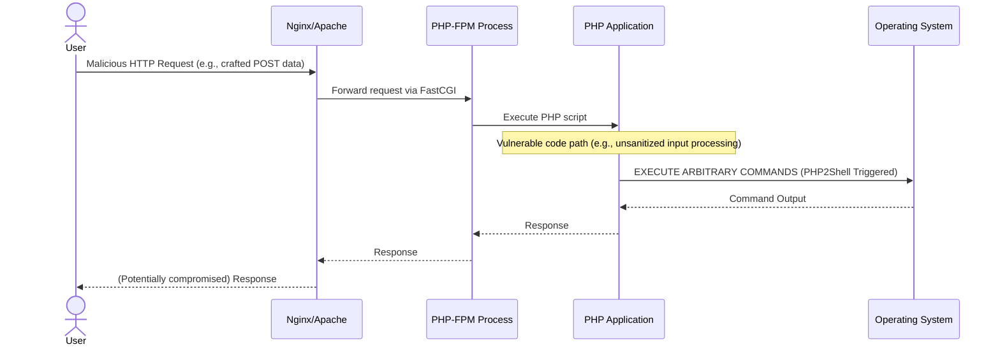

## The Breakthrough in 60 Seconds

Drop everything. PHP, the bedrock of a significant portion of the internet, is facing an imminent, critical security crisis. Maintainers have issued an urgent advisory, warning web developers to prepare for not one, but *two* emergency patches set for immediate release. While details remain sparse and unconfirmed, the whispers in the security community point to a terrifyingly effective Remote Code Execution (RCE) vulnerability, reportedly dubbed "PHP2Shell." This isn't a drill; this is a full-scale alert for every organization running PHP, from the smallest blog to the largest enterprise application. The potential for widespread, automated compromise is, frankly, staggering.

## Architectural & Technical Deep Dive

PHP's ubiquity is its greatest strength and, in moments like these, its most profound vulnerability. Powering everything from WordPress and Laravel to countless bespoke applications, its reach is unparalleled. An RCE exploit, especially one as potentially potent as PHP2Shell suggests, targets the very core of how PHP processes requests and executes code, turning legitimate server functionality into an attacker's playground.

Let's hypothesize the vector for an exploit like PHP2Shell. Given the name, it strongly implies the ability to inject and execute arbitrary shell commands directly on the host server. Common avenues for such an attack include:

*   **Input Sanitization Failures**: The classic flaw. Unfiltered user input in parameters, headers, or file uploads that allows injection of shell commands (`system()`, `exec()`, `shell_exec()`, `passthru()`) or even PHP code (`eval()`).
*   **Deserialization Vulnerabilities**: Exploiting `unserialize()` with crafted data to trigger object injection, leading to arbitrary method calls or property manipulation that ultimately results in RCE.
*   **File Inclusion/Upload Vulnerabilities**: Allowing attackers to upload malicious PHP files (web shells) or include remote files that contain exploit code.
*   **Environment Variable Manipulation**: Less common, but possible in specific configurations, where environment variables can be manipulated to influence PHP's execution context.

Regardless of the precise mechanism, the goal is consistent: bypass the application's intended logic and execute commands at the operating system level. The impact varies slightly depending on the PHP execution model:

*   **`mod_php` (Apache)**: If Apache runs with elevated privileges (which it shouldn't, but legacy systems exist), an RCE here could grant root access. Otherwise, it operates under the Apache user.
*   **`PHP-FPM` (Nginx/Apache)**: The more common and generally more secure setup. FPM processes typically run as a dedicated, unprivileged user (e.g., `www-data`). While this limits direct root access, an RCE still grants full control over the web application, its data, and potential lateral movement within the compromised server or network.
*   **Containerized Environments**: Docker or Kubernetes deployments provide process isolation. An RCE would compromise the specific container, but sophisticated attacks could leverage container escape vulnerabilities to affect the host. However, the immediate blast radius is often confined to the container itself, making patching and redeployment faster.

Here's a simplified architectural flow illustrating the critical vulnerability point:

The compute economics here shift from optimization to risk mitigation. The cost of a successful RCE isn't measured in milliseconds of latency, but in data breaches, regulatory fines, reputational damage, and the extensive compute cycles an attacker can leverage for crypto-mining, DDoS, or further network penetration.

## Industry Impact: Who Wins, Who Gets Disrupted?

This isn't just a technical hiccup; it's a seismic event for the web ecosystem. The fallout will be unevenly distributed.

**Significant Disruption for:**

*   **Small and Medium Businesses (SMBs)**: Often lack dedicated security teams, run outdated PHP versions, and rely on shared hosting where patching is out of their direct control. They are prime targets.
*   **Legacy Systems**: Enterprises with sprawling, unmanaged PHP applications, or those relying on end-of-life PHP versions, face an existential threat. Patching these often involves complex regression testing or even rewriting.
*   **Shared Hosting Providers**: Will be in a frantic race against time to patch thousands of servers, potentially leading to service disruptions and customer dissatisfaction.
*   **Managed WordPress/CMS Providers**: While generally more proactive, the sheer volume of installations means a massive coordinated effort to update core, plugins, and themes.
*   **Organizations with Poor Asset Management**: If you don't know where all your PHP instances are, you can't patch them. This incident will ruthlessly expose gaps in inventory and configuration management.

**Those Who Stand to Benefit (or are better positioned):**

*   **Security Vendors**: Web Application Firewalls (WAFs), Endpoint Detection and Response (EDR), vulnerability scanners, and incident response firms will see a surge in demand.
*   **Cloud-Native Architectures**: Organizations leveraging serverless functions or container orchestration (Kubernetes) often have more agile deployment pipelines, enabling faster patching and rollback. Immutable infrastructure principles make it easier to replace compromised instances.
*   **Organizations with Robust DevOps & CI/CD**: The ability to rapidly test, deploy, and monitor patches across environments is a critical advantage. This is where investment in automation truly pays off.
*   **Alternative Language Ecosystems**: While PHP isn't going anywhere, incidents like this inevitably spark discussions about diversification, potentially nudging some projects towards Go, Rust, Node.js, or Python for new development.

Economically, the impact will be measured in millions, if not billions, of dollars globally. Beyond the direct costs of breaches and incident response, the erosion of trust and the diversion of engineering resources from innovation to remediation represent a substantial drag on the digital economy.

## The FluxFuse Perspective: What Builders Must Do Now

At FluxFuse Technologies, we build for builders. We understand the relentless pace and the absolute necessity of reliable, secure tooling. This PHP crisis is a stark reminder that even the most mature and widely adopted technologies are susceptible to critical vulnerabilities. For software engineers, product builders, and autonomous workflow creators, the directive is clear and urgent:

**For Software Engineers & DevOps Teams:**

1.  **Immediate Asset Inventory**: You cannot secure what you don't know you have. Scan your entire infrastructure – cloud, on-prem, containers, VMs – for *all* PHP installations and their versions. Don't forget development, staging, and forgotten internal tools.
2.  **Patch Management Activation**: Prepare your patch deployment pipelines. Ensure you have rollback strategies in place. As soon as the emergency patches are released, prioritize their application across all affected systems. This is not a task for next sprint; it's for *now*.
3.  **Defense in Depth Review**: This incident highlights the need for layered security. Review your WAF rules for suspicious patterns, enforce least privilege for PHP processes, and ensure robust network segmentation. Consider moving sensitive data out of reach of web-facing servers.
4.  **Code Audit Focus**: While patching is primary, use this as an opportunity to review critical PHP code paths for common RCE vectors: `eval()`, `unserialize()`, `shell_exec()`, and file upload/inclusion logic. Implement strict input validation and output encoding everywhere.
5.  **Enhanced Monitoring & Alerting**: Implement or refine monitoring for unusual process execution, outbound network connections from web servers, unexpected file changes, and elevated error rates. An early warning system could be the difference between a close call and a catastrophic breach.

**For Product Builders & Tech Leads:**

1.  **Risk Communication**: Understand the potential blast radius for your product. Prepare internal and external communication plans. Transparency with customers, if affected, builds trust.
2.  **Security as a Product Feature**: This incident reinforces that security isn't just an operational afterthought; it's a core component of product integrity and customer value. Invest in secure development practices and security champions within your teams.
3.  **Dependency Security**: If your product integrates with third-party PHP services or libraries, assess their patch readiness. Your security is only as strong as your weakest link in the supply chain.

**For Autonomous Workflow Creators (AI & Automation):**

1.  **API & Integration Security**: If your AI automations interact with PHP-powered APIs or services, assume compromise potential. Implement strict API gateway policies: authentication, authorization, rate limiting, and input validation on *all* incoming and outgoing data.
2.  **Isolated Environments**: Ensure your critical AI components and data pipelines run in maximally isolated environments. A compromised web server should not lead to a compromised data lake or AI model repository.
3.  **Supply Chain AI Risks**: Be aware that data processed by compromised PHP systems could be tainted or manipulated before it ever reaches your AI models, leading to biased or malicious outputs. Validate data sources rigorously.

At FluxFuse, we advocate for architectures that are resilient by design. This means not only building with robust frameworks but also fostering a culture of continuous security vigilance. Our desktop utilities like Notchgent, and our enterprise AI automations, are built with this principle at their core, minimizing external dependencies where possible and rigorously vetting those that remain. This PHP warning is a clarion call for every builder to re-evaluate their security posture.

## Key Takeaways & Source Citation

*   **Imminent Threat**: PHP maintainers are releasing two emergency patches for a critical RCE vulnerability, reportedly dubbed "PHP2Shell."
*   **Widespread Impact**: The exploit could allow attackers to execute arbitrary code on web servers, affecting a vast number of applications globally.
*   **Urgent Action Required**: Prioritize asset inventory, prepare patch deployment, review defense-in-depth strategies, and enhance monitoring immediately.
*   **Security is Paramount**: This incident underscores the critical importance of proactive security practices across all layers of development and operations.

**Source:** [Ars Technica: PHP maintainers tell web devs to prepare themselves for critical security patches](https://arstechnica.com/security/2026/10/php-maintainers-tell-web-devs-to-prepare-themselves-for-critical-security-patches/)
