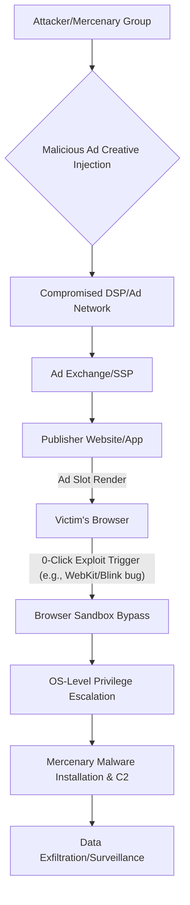

## The Breakthrough in 60 Seconds

The digital advertising ecosystem, long derided for its surveillance capitalism, has just crossed a perilous new threshold. For the first time, we have confirmed evidence that the very mechanisms designed to deliver tailored product pitches are now actively weaponized to deploy sophisticated, 0-click mercenary spyware. This isn't theoretical; it's a realized attack vector where a targeted ad, without any user interaction – no clicks, no downloads – can compromise a device and install surveillance malware. The implications for privacy, enterprise security, and the integrity of the internet itself are profound and immediate.

## Architectural & Technical Deep Dive

This incident exposes critical vulnerabilities not just in browser security, but in the sprawling, opaque, and latency-sensitive architecture of programmatic advertising. To understand how a malicious actor weaponizes an ad, we must dissect the multi-layered attack surface.

### The Vulnerable Ad Tech Supply Chain

The programmatic ad landscape is a complex mesh of Demand-Side Platforms (DSPs), Supply-Side Platforms (SSPs), Ad Exchanges, Data Management Platforms (DMPs), and Content Delivery Networks (CDNs). Real-Time Bidding (RTB) occurs in milliseconds, a high-speed auction where ads are selected and rendered. This speed is a critical weakness:

1.  **Creative Ingestion & Validation**: Malicious actors can inject poisoned ad creatives (HTML5, JavaScript, WebAssembly) into DSPs or ad networks. While validation exists, sophisticated cloaking techniques (e.g., serving benign content to scanners and malicious content to target IPs/user agents) can bypass checks.
2.  **Targeting Precision**: The very data collected for ad targeting (IP addresses, browser fingerprints, device types, location) allows attackers to precisely deliver their exploit to specific, high-value targets, minimizing noise and detection risk.
3.  **Latency & Scale**: The sheer volume and rapid turnover of ad impressions make real-time, deep content inspection economically unfeasible at scale for many ad platforms.

### The 0-Click Exploit Vector

Once a malicious ad creative is served to a victim's browser, the 0-click exploit triggers without user interaction. This typically involves:

*   **Browser Engine Vulnerabilities**: Exploits target flaws in rendering engines (e.g., WebKit, Chromium's Blink, Firefox's Gecko), JavaScript JIT compilers, image decoders, or font parsers. These are often memory corruption bugs (use-after-free, heap overflows) that allow arbitrary code execution.
*   **Sandbox Escape**: Modern browsers employ sandboxes to isolate web content from the underlying operating system. A successful 0-click exploit often requires a second-stage vulnerability to escape this sandbox and gain higher privileges on the OS.
*   **Payload Delivery**: The exploit then downloads and executes the mercenary malware. This payload is often small, highly obfuscated, and uses advanced anti-analysis techniques.

Consider a simplified attack flow:

### Compute Economics & Stealth

The economics here are chilling. By leveraging the existing ad tech infrastructure, attackers offload significant distribution costs. Targeting specific high-value individuals means a relatively small number of successful compromises can yield immense intelligence value, justifying the development cost of sophisticated 0-click exploits. The transient nature of ad impressions also makes forensic analysis challenging; by the time an anomaly is detected, the malicious ad creative may have long since rotated out of circulation.

## Industry Impact: Who Wins, Who Gets Disrupted?

This development sends shockwaves across multiple industries, redefining threat models and forcing a re-evaluation of digital trust.

### Disrupted:

*   **Ad Tech Platforms**: Trust is the bedrock of advertising. This incident severely erodes it, inviting greater regulatory scrutiny (GDPR, CCPA on steroids) and potentially leading to a mass exodus of privacy-conscious users to ad blockers or privacy-focused browsers. The cost of 'secure' ad delivery will skyrocket.
*   **Browser Vendors**: The pressure to harden rendering engines, JIT compilers, and sandboxing mechanisms will intensify. Expect faster patch cycles and a renewed focus on memory-safe languages for core browser components.
*   **Publishers**: Caught in the middle, publishers relying on ad revenue face a dilemma: risk user compromise or explore alternative monetization models. Their brand reputation is now directly tied to the security posture of their ad partners.
*   **Enterprise Security Teams**: Traditional perimeter defenses are insufficient. This demands advanced Endpoint Detection and Response (EDR), browser isolation solutions, and a zero-trust approach to *all* client-side activity, including what originates from supposedly benign ad slots.

### Wins (or those who benefit from the disruption):

*   **Security Vendors**: Especially those specializing in advanced threat intelligence, browser isolation, EDR/XDR, and client-side web security. The market for proactive defense and forensic tools against such sophisticated attacks will surge.
*   **Privacy-Focused Browsers & Tools**: Browsers like Brave, Vivaldi, and extensions like uBlock Origin or Privacy Badger will see increased adoption as users seek to mitigate this new threat vector.
*   **Zero-Trust Architecture Evangelists**: This incident is a stark validation of the 'never trust, always verify' principle, extending it deeply into the user's interaction with the web.
*   **Alternative Monetization Models**: Subscription services, direct sponsorships, and other non-ad-based revenue streams will gain new traction as a 'safer' alternative for publishers.

## The FluxFuse Perspective: What Builders Must Do Now

At FluxFuse Technologies, we build for a future where software is robust, secure, and empowers creators. This incident is a harsh reminder that the foundations we build upon are constantly under assault. For software engineers, product builders, and autonomous workflow creators, this isn't just news; it's a call to action.

### For Software Engineers:

Your code is now potentially on the front lines of mercenary warfare. Focus on:

*   **Memory Safety First**: Double down on languages and practices that prioritize memory safety (Rust, modern C++ patterns, rigorous fuzzing). Memory corruption bugs are the bedrock of these exploits.
*   **Aggressive Sandboxing & Isolation**: If your application renders *any* external content, apply the strictest possible Content Security Policies (CSPs), Feature Policies, and consider WebAssembly for highly sensitive operations. Explore technologies like browser isolation or rendering content in ephemeral, disposable environments.
*   **Dependency Scrutiny**: The ad tech supply chain is compromised; so can be your npm, PyPI, or Maven dependencies. Implement robust supply chain security checks, including static analysis of third-party libraries for potential vulnerabilities, especially those that touch content rendering or network communication.
*   **Observability & Anomaly Detection**: Instrument your client-side applications and infrastructure to detect unusual network requests, unexpected process spawns, or abnormal resource consumption that might indicate an exploit in progress. Think beyond traditional server-side logs.

### For Product Builders:

User trust is your most valuable asset. This incident weaponizes the very interfaces users interact with daily. Consider:

*   **Re-evaluate Monetization**: Can you reduce reliance on programmatic advertising? Explore subscription models, direct sponsorships, or value-exchange frameworks that give users more control and reduce the attack surface.
*   **Security as a Differentiator**: Position your product's security and privacy posture as a core competitive advantage. Transparently communicate how you protect users from emerging threats, rather than burying it in a privacy policy.
*   **Default to Least Privilege**: Design products where user-facing components, especially those handling external content, operate with the absolute minimum necessary permissions.

### For Autonomous Workflow Creators:

AI agents interacting with the web are now prime targets. The 'eyes' of your agents could become entry points for sophisticated attacks. Implement:

*   **Ephemeral Agent Environments**: Any autonomous agent that browses or interacts with web content must do so within a strictly isolated, ephemeral environment that is destroyed after each task or session. Think fire-and-forget virtual machines or containers.
*   **Strict Input Sanitization & Validation**: Treat all content retrieved from the internet, even seemingly benign elements within an ad slot, as potentially malicious. Apply rigorous sanitization before any processing or rendering by your agent.
*   **Behavioral Anomaly Detection for Agents**: Implement AI-driven monitoring to detect unusual network requests, process executions, or data access patterns originating from your autonomous agents, particularly after they've processed web content.
*   **Principle of Least Privilege (Agent Edition)**: Your agents should only have access to the resources and permissions absolutely necessary for their current task. If an agent's task involves web browsing, it should have no direct access to sensitive internal systems.

## Key Takeaways & Source Citation

This confirmed incident marks a dangerous escalation: targeted ads are no longer just privacy intrusions; they are now a confirmed vector for 0-click mercenary malware. This forces an urgent re-evaluation of ad tech security, browser hardening, and client-side protection strategies across the board. For builders, it's a critical moment to prioritize security, build with defense-in-depth, and rethink the fundamental trust models of our digital interactions.

**Source Citation:** [Targeted ads delivered 0-click exploits to install mercenary malware](https://arstechnica.com/security/2026/10/targeted-ads-delivered-0-click-exploits-to-install-mercenary-malware/)
